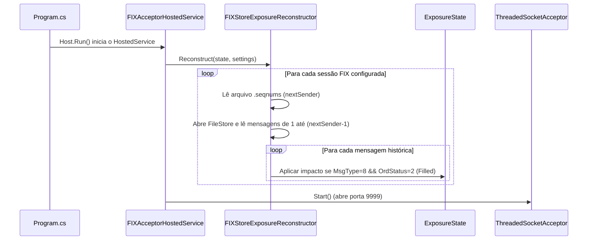
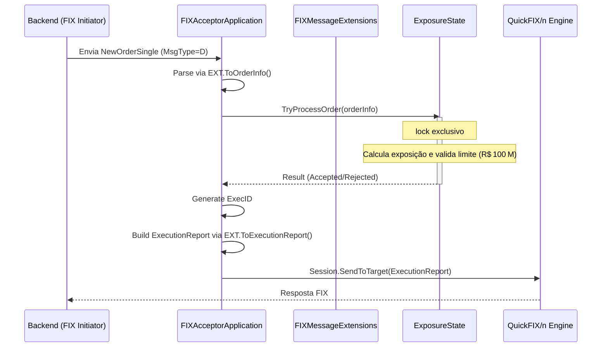

# OrderAccumulator – Fluxo de Execução

Este documento descreve o fluxo de funcionamento atualizado do **OrderAccumulator**, detalhando as duas fases principais da aplicação, os componentes envolvidos e as responsabilidades de cada um.

---

## Visão Geral

O OrderAccumulator recebe ordens de compra/venda via FIX, calcula a exposição monetária e garante que o limite máximo de **R$ 100 milhões** não seja ultrapassado. O estado de exposição é mantido em memória e reconstruído a partir do histórico de mensagens armazenado no **FileStore** do QuickFIX/n sempre que a aplicação é iniciada.

---

## Fase 1 – Inicialização e Reconstrução de Estado

Esta fase ocorre **antes** de abrir o servidor FIX para novas conexões. O objetivo é reconstruir a exposição acumulada a partir das mensagens já enviadas em sessões anteriores.



**Passos detalhados**
1. **Program.cs** cria o host genérico do .NET e registra o serviço `FIXAcceptorHostedService`.
2. `FIXAcceptorHostedService.StartAsync` invoca `FIXStoreExposureReconstructor.Reconstruct`.
3. O reconstrutor localiza o arquivo `.seqnums` da sessão (ex.: `FIX.4.4-ACCUMULATOR‑BACKEND.seqnums`) e extrai `nextSender`.
4. Utiliza o `IMessageStore` nativo do QuickFIX/n para carregar todas as mensagens enviadas (`store.Get(1, nextSender‑1, messages)`).
5. Para cada `ExecutionReport` com `OrdStatus=2` (Filled), calcula‑se a exposição (`Qty * Price`) e chama `ExposureState.ApplyHistoricalExposure`, **ignorando** a validação de limite, pois essas ordens já foram aceitas previamente.
6. Ao final da reconstrução, o `ThreadedSocketAcceptor` é iniciado, permitindo que novos clientes se conectem.

---

## Fase 2 – Processamento em Tempo Real

Nesta fase, cada nova mensagem `NewOrderSingle` (MsgType = 'D') recebida é processada de forma concorrente.



**Principais componentes**
- **`FIXAcceptorApplication`** (`src/OrderAccumulator.Infrastructure/FIX/FIXAcceptorApplication.cs`): implementa `IApplication` do QuickFIX/n. No método `FromApp` recebe a mensagem, converte‑a usando os **extension methods** (`Message.ToOrderInfo()`), delega a validação a `ExposureState` e envia o `ExecutionReport`.
- **`FIXMessageExtensions`** (`src/OrderAccumulator.Infrastructure/FIX/FIXMessageExtensions.cs`): contém os métodos de extensão `ToOrderInfo` e `ToExecutionReport` que encapsulam a lógica de serialização/deserialização, removendo a necessidade de uma classe estática separada.
- **`ExposureState`** (`src/OrderAccumulator.Core/ExposureState.cs`): gerencia o saldo de exposição com `lock (_stateLock)` garantindo thread‑safety. O método `TryProcessOrder` avalia o limite de R$ 100 M e atualiza o estado quando a ordem é aceita.
- **`FIXStoreExposureReconstructor`** (`src/OrderAccumulator.Infrastructure/FIX/FIXStoreExposureReconstructor.cs`): responsável pela fase 1 de replay de mensagens históricas.

---

## Estrutura de Diretórios

```
OrderAccumulator/
├─ src/
│  ├─ OrderAccumulator.Core/          # Lógica de domínio (ExposureState, modelos)
│  └─ OrderAccumulator.Infrastructure/ # Integração FIX (Application, Extensions, Reconstructor)
├─ tests/                               # Testes de integração e unidade
└─ README.md                            # Este documento
```

---

## Testes de Integração

- **Caso A** – `Test_CrashRecovery_ReconstructsExposureFromStore`: verifica que o reconstrutor restaura a exposição correta a partir do FileStore.
- **Caso B** – `Test_UnprocessedMessageReplayedDuringCrashIsProcessed`: garante que mensagens não processadas antes de um crash são reaplicadas corretamente.

Ambos os testes podem ser executados com `dotnet test` e permanecem verdes após as refatorações.
- Todos os 3 testes são aprovados (`dotnet test` → 3 passed).
---